# Radbit Auto — illustrated guidebook

A visual tour of the customer import and dealership portal, from first sign-up through to a customer following their own import.

Portal: https://studio-285787437-bc95b.web.app · Custom domain: https://auto.radbitstudios.co.zw
Support: brandontinoz@gmail.com

> **About these screenshots.** Every image below was captured by the automated `web/e2e/guidebook.spec.ts` journey running against isolated local Firebase emulators. The agency shown ("E2E Motors"), its staff, customers, vehicle and case are synthetic fixtures, not real client data. Names, prices and balances are illustrative. All amounts are USD.

## Contents

- [1. Getting started](#1-getting-started) — landing, sign-up, support
- [2. Dealer onboarding](#2-dealer-onboarding) — register the agency, land on the dashboard
- [3. Building records](#3-building-records) — add a customer and a vehicle
- [4. Running the dealership](#4-running-the-dealership) — enquiries, stock, photos
- [5. Going public](#5-going-public) — the shareable showroom
- [6. Sales, reporting and administration](#6-sales-reporting-and-administration)
- [7. The customer portal](#7-the-customer-portal)

---

## 1. Getting started

### The public home page

Prospective buyers can browse intentionally published, available stock and reach the owning dealer's showroom. Business prospects can start their own agency workspace.

### Create your owner account

Choose **Create your agency workspace** and enter your name, email and a password. Verify the email we send you, then return to the portal.

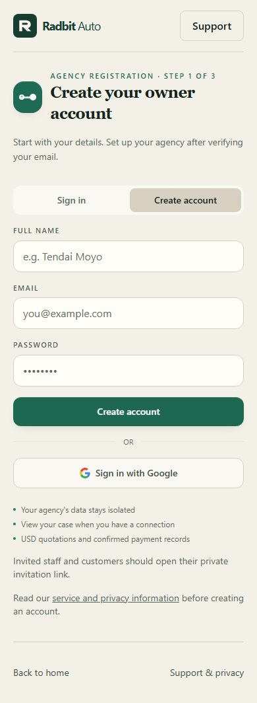

### Support and privacy

The support page explains data handling, account recovery and how to report an issue. Report problems with the case number — never email passwords or supplier credentials.

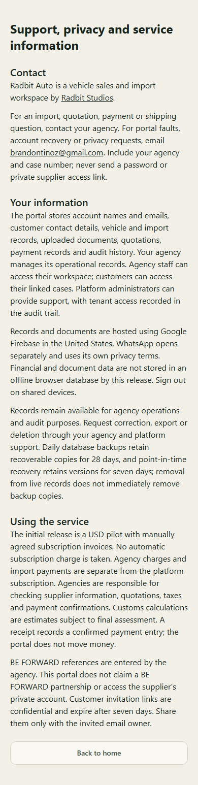

---

## 2. Dealer onboarding

### Register your agency (email verification)

Agency registration is a three-step wizard. Until the email is verified, the setup form stays locked behind the verification step. After verification you set your agency name, unique showroom address (e.g. `/showroom/city-motors`), WhatsApp number, case prefix, default arrival port and whether you handle sourcing, clearing or both.

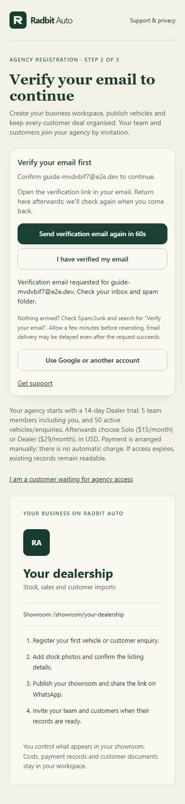

### Your dashboard

The dashboard ("Your work today") is the daily starting point: a first-steps checklist, sales and stock counters, the attention queue and recent imports, plus a search box across case number, customer or VIN.

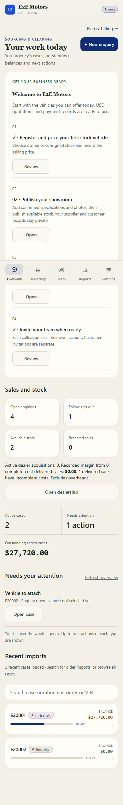

---

## 3. Building records

### Add a customer

Add the customer before opening an enquiry. The vehicle is optional at first — attach it once it is sourced. Japanese chassis/frame numbers are accepted.

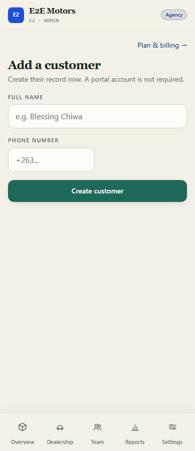

### Register a vehicle

Register vehicles with their chassis/frame number, make, model and year. A registered vehicle can then be added to dealer stock and published.

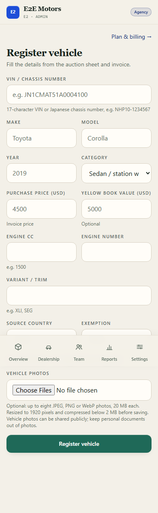

---

## 4. Running the dealership

### Capture an enquiry (lead)

Open **Dealership → Leads** and record the buyer, their budget and vehicle preferences. The lead card shows the status and the next step; leads can be converted into a customer and import case.

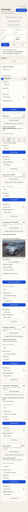

### Stock detail, photos and pricing

Each stock record carries ownership (owned or consigned), asking price, location and recorded costs. Upload photos, choose the cover shot, add buyer-facing specifications and publish the listing. Costs and private records stay in your workspace.

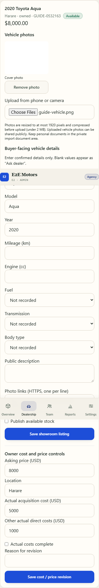

---

## 5. Going public

### The shareable showroom

Publishing available stock makes it eligible for both your showroom and the shared marketing catalogue. Reserved and sold vehicles are excluded, and VINs, buyer details and acquisition costs are never exposed. Share the showroom link on WhatsApp.

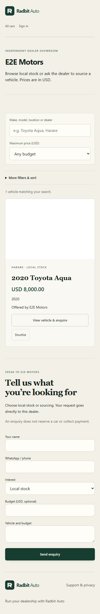

---

## 6. Sales, reporting and administration

### Reserve a vehicle for a buyer

Reserve available stock against a buyer to hold it. Confirmed payment is recorded after checking evidence, and handover requires full payment.

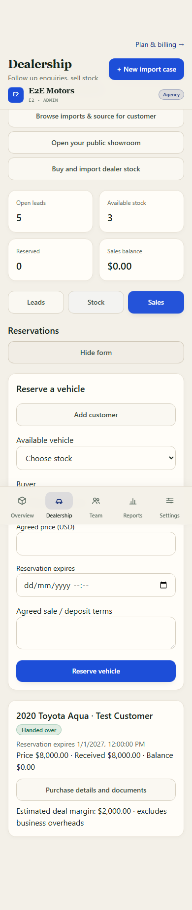

### Reports

Reports show dealership-wide cases, confirmed collections, outstanding balances and quoted fees. Collections are not profit.

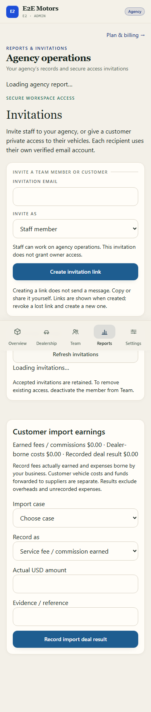

### Invitations

From Team → Invitations, create staff or customer invitations. Each colleague or customer uses their own account and the invited email address. Links expire after seven days and can be revoked.

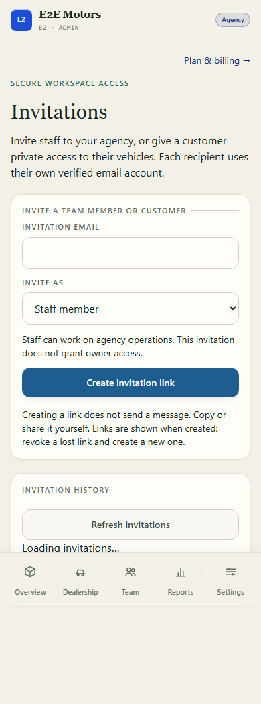

### Bulk import (CSV / Excel)

Owners can import customers or stock from CSV or .xlsx files. Files are read locally; only mapped fields are submitted. Preview each row before committing, and download the result to correct any skipped rows.

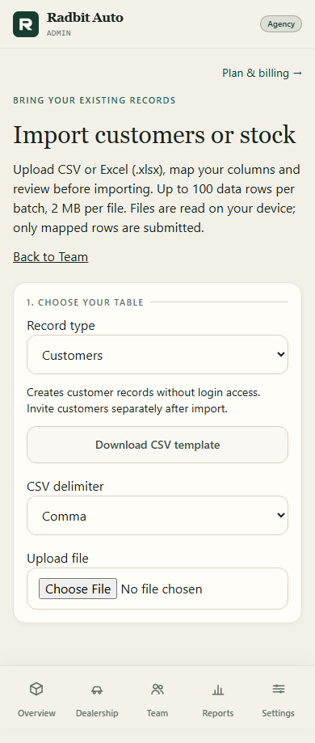

### Plan and billing

New agencies start on a 14-day Dealer trial. Plan changes are arranged manually in USD — there is no automatic charge, and a plan request does not change access until the platform operator records the payment references.

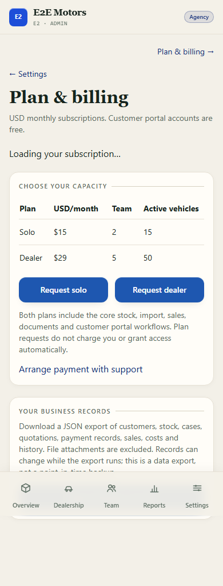

---

## 7. The customer portal

### My vehicles

Customers sign in to a dedicated portal showing their purchases and imports, confirmed payments, next steps and balances.

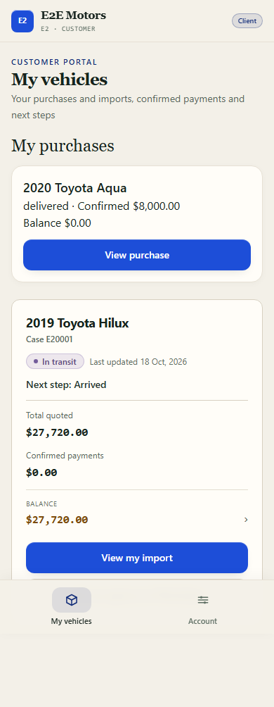

### Following an import

A customer opens their case to follow the current stage, quotation, confirmed payments and outstanding balance on their phone, with a direct WhatsApp action to contact the agency.

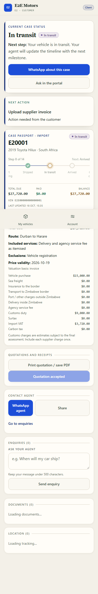

---

For the step-by-step onboarding checklist see [../CLIENT_ONBOARDING.md](../CLIENT_ONBOARDING.md). Operational detail, limits and honest scope boundaries are recorded in [../OPERATIONS_RUNBOOK.md](../OPERATIONS_RUNBOOK.md).
